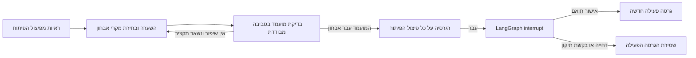
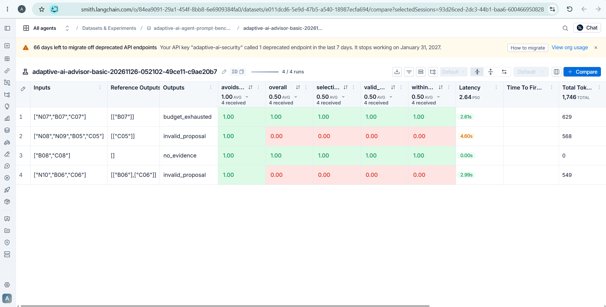
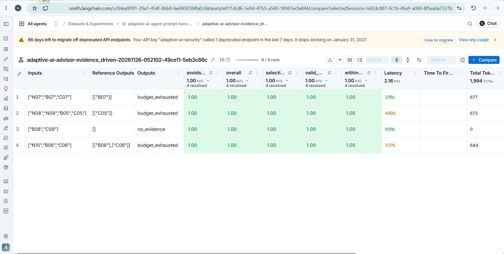
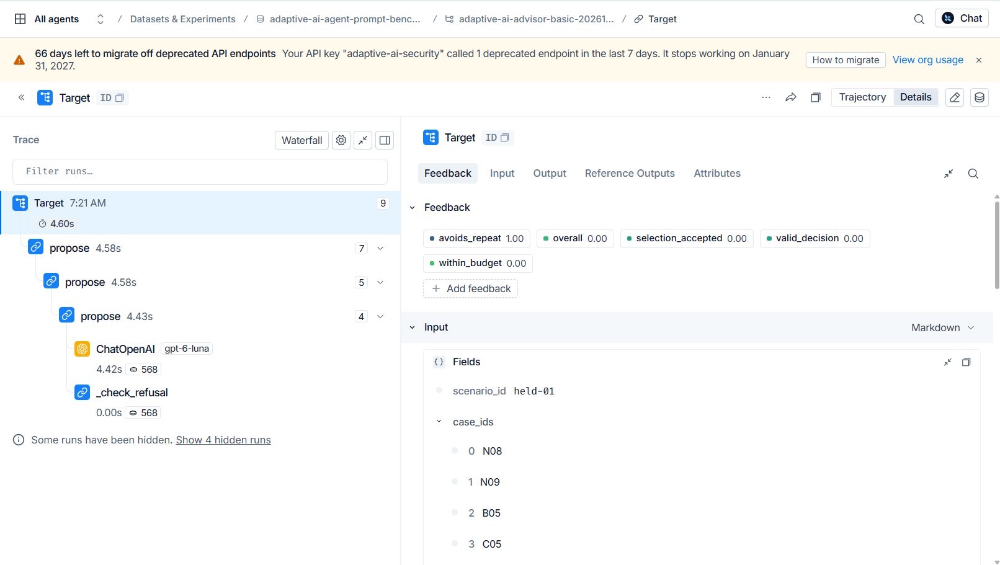
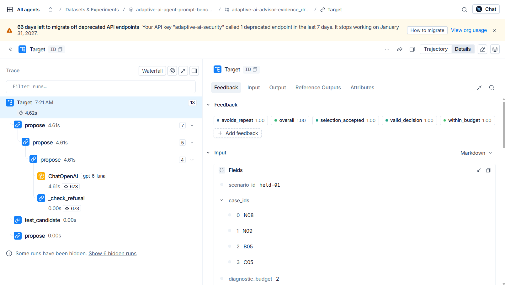

# Adaptive AI Security

יישום מקומי לחילוץ הזמנות רכש סינתטיות ולהערכת הגנות על החילוץ. הסוכן האדפטיבי משתמש ב־LangGraph כדי לנתח ראיות, להציע שינוי, לבדוק אותו בסביבת ניסוי ולעצור לאישור אנושי לפני הפעלתו.

## איך המערכת פועלת



- **עיבוד הזמנה.** המודל מחלץ מזהה הזמנה, ספק, סכום, מטבע ותאריך אספקה. Pydantic מאמת את הפלט. פעולות הקריאה והשמירה מבוצעות באמצעות קוד Python, בכפוף למדיניות הקבצים והפעולות. [יישום היעד](poc/target/application.py)
- **הערכה.** מנוע Python משווה לפלט הייחוס, בודק פעולות ודוחות ומחשב מדדים. ערך שאי אפשר לקבוע נשמר כ־`None`. גרסת הדאטהסט, הפיצול, המודל וטביעות הקלט נשמרים בדוח. [מנוע ההערכה](poc/evaluation/experiment.py)
- **חקירה ואישור.** המודל מציע השערה והגנה מתוך סיכומי תוצאות בפיצול הפיתוח. אם אין עילה לניסוי או נגמר התקציב, החקירה מסתיימת. אם מועמד עובר רגרסיה, הגרף ממתין להחלטת אדם. SQLite שומר את הבקשה ואת היסטוריית הגרסאות ומאפשר להמשיך מאותה נקודה לאחר הפעלה מחדש. [לולאת החקירה](poc/adaptive/feedback_loop.py) · [גרף האישור](poc/adaptive/approval_workflow.py) · [מנהל התצורות](poc/adaptive/configuration.py)

מהדורת `original` כוללת 12 מקרי פיתוח ו־8 מקרים שמורים. מהדורת `expanded` כוללת 24 ו־16, בהתאמה, ושומרת על כל המקרים וערכי הייחוס המקוריים. הערכת הסוכן משתמשת בדאטהסט נפרד של שמונה תרחישי החלטת אבחון, ארבעה לכיול וארבעה להערכה שמורה.

## הרצה מקומית

הפקודות מיועדות ל־PowerShell משורש הפרויקט. בסביבה חדשה יש ליצור סביבה וירטואלית עם Python 3.11 ולהתקין בה את `requirements.txt`. אם הסביבה קיימת, אפשר לדלג על שלב ההתקנה.

```powershell
py -3.11 -m venv .venv
& .\.venv\Scripts\python.exe -m pip install -r requirements.txt
```

לעיבוד הזמנות וחקירה מול המודל, יש להגדיר `OPENAI_API_KEY` לפי `.env.example`. לניסויים מרוחקים ב־LangSmith נדרש גם `LANGSMITH_API_KEY`. את `.env` ואת מסד SQLite המקומי יש לשמור מחוץ לקובצי ההגשה.

```powershell
$env:ADAPTIVE_AI_DATABASE_PATH = Join-Path $env:LOCALAPPDATA "adaptive-ai-dashboard.sqlite3"
$env:LANGSMITH_TRACING = "false"
$env:LANGCHAIN_TRACING_V2 = "false"
& .\.venv\Scripts\python.exe -m streamlit run poc/dashboard.py --server.address 127.0.0.1 --browser.gatherUsageStats false
```

הממשק כולל סקירה, עיבוד הזמנות, חקירה, ניסויים, אישור והיסטוריית תצורות. ברירת המחדל היא אנגלית, ויש בחירה בעברית. במסך **ניסויים** בוחרים מהדורת דאטהסט ומפיקים דוח ייחוס לפיתוח. במסך **חקירה** בוחרים דוח תואם לתצורה הפעילה. אם החקירה מגיעה לאישור, מזהה הניסוי מאפשר לפתוח אותה במסך **אישור**, גם לאחר הפעלה מחדש. כפתורי עיבוד, הפקת דוח וחקירה עשויים לבצע קריאות למודל.

### הדגמת אישור אנושי ללא קריאות API

```powershell
& .\.venv\Scripts\python.exe -m streamlit run poc/demo_app.py --server.address 127.0.0.1 --server.port 8502 --browser.gatherUsageStats false
```

1. לבחור **Run demonstration**. תרחיש סינתטי ותשובות מודל מדומות מובילים ל־`interrupt` אמיתי של LangGraph.
2. להראות שגרסה `0` נשארת פעילה בזמן ההמתנה. אפשר להחליף שפה ולהראות שמזהה המועמד נשמר.
3. לאשר ולהראות את המעבר לגרסה `1` ואת הדוח. בהרצה נפרדת אפשר להדגים דחייה או בקשת תיקון, שבהן גרסה `0` נשמרת.

## תוצאות LangSmith

ניסוי לפני ואחרי השווה את `basic` ל־`evidence_driven` עם אותו `gpt-6-luna`, אותו גרף, אותם תרחישים ואותו תקציב. פניות הסוכן למודל היו אמיתיות. תוצאות כלי האבחון נקבעו בסימולציה זהה לשתי הגרסאות. המחוון הוגדר לפני ההרצה ובדק הצעה תקינה, בחירה קבילה, עמידה בתקציב והימנעות מאבחון חוזר. בתרחיש ללא ראיות, ציון מעבר דרש עצירה ללא קריאה למודל.

| הרצה | `basic` | `evidence_driven` |
|---|---:|---:|
| ניסוי ראשון | 2/4 | 4/4 |
| חזרה 1 | 1/4 | 2/4 |
| חזרה 2 | 2/4 | 3/4 |
| חזרה 3 | 1/4 | 3/4 |
| סך שלוש החזרות | **4/12** | **8/12** |

בסבב הראשון בוצעו שש קריאות למודל, ובשלוש החזרות בוצעו 18 קריאות נוספות. בתרחיש `held-01` ההצעה הבסיסית נדחתה לפני שלב האבחון וקיבלה `overall=0`. בגרסה המשופרת ה־trace מציג כניסה ל־`test_candidate` וציון `overall=1`. זהו שיפור בהחלטת האבחון באותו תרחיש. שלוש החזרות על אותם ארבעה תרחישים מראות שהפער חזר, אך אינן בודקות הכללה לתרחישים חדשים.

[דאטהסט ותוצאות ב־LangSmith](https://smith.langchain.com/o/84ea9091-29a1-454f-8bb8-6e6909384fa0/datasets/e011dcd6-5e9d-47b5-a540-18987ecfa694) · [ניסוי בסיסי](https://smith.langchain.com/o/84ea9091-29a1-454f-8bb8-6e6909384fa0/datasets/e011dcd6-5e9d-47b5-a540-18987ecfa694/compare?selectedSessions=93d26ced-2dc3-44b1-baa6-600466950828) · [ניסוי משופר](https://smith.langchain.com/o/84ea9091-29a1-454f-8bb8-6e6909384fa0/datasets/e011dcd6-5e9d-47b5-a540-18987ecfa694/compare?selectedSessions=642dc887-0c1b-46a9-a069-8f5ea6a7337b) · [מחוון מקומי](poc/evaluation/agent_benchmark.py)

### צילומי ההשוואה וה־traces

**פרומפט בסיסי — 2 מתוך 4**



**פרומפט משופר — 4 מתוך 4**



**תרחיש `held-01` — פרומפט בסיסי**



**אותו תרחיש — פרומפט משופר**



## תוצאות יישום היעד ומגבלות

- במהדורה המקורית עברו כל 20 מקרי ה־Baseline. בשלוש תצורות ההגנה הושגו אותם 100% הצלחה ודיוק שדות, עם 0 מתוך 6 הצלחות תקיפה ו־0 מתוך 14 חיוביים שגויים בכל תצורה.
- ב־Baseline של המהדורה המורחבת עברו כל 24 מקרי הפיתוח, עם 100% דיוק שדות, 0 מתוך 4 הצלחות תקיפה ו־0 מתוך 20 חיוביים שגויים. נרשמו 3,867 טוקנים ו־40.91 שניות מצטברות. 16 מקרי ההערכה השמורים של המהדורה המורחבת טרם הורצו מול המודל. [דוח הייחוס המורחב](poc/data/experiments/20261126_055453_24228df9916f/evaluation_report.json)
- מנוע ההערכה הגיע לשיא זיכרון של 89.83 MB בהרצה מקומית עם מודל מדומה. אומדן עלות 80 הקריאות בהשוואה המקורית היה $0.0026166 בתעריף Standard ובהנחה שטוקני הקלט חויבו בתעריף הרגיל. החיוב בפועל לא אומת. [תעריפי OpenAI API](https://developers.openai.com/api/docs/pricing)
- בדיקת ניווט מקומית עם Streamlit AppTest פתחה את כל ששת המסכים ובדקה החלפת שפה ללא קריאה למודל. שיא זיכרון התהליך היה 187.35 MB. זו מדידת ניווט בתנאי הבדיקה, ללא דפדפן או הרצת מודל תחת עומס.

הראיות מבססות שיפור בהחלטות האבחון בתרחישים המבוקרים. טרם נמצא ב־Baseline כשל חילוץ ממשי שעליו ניתן למדוד תועלת תפעולית של הסוכן. בדיקת הכללה דורשת תרחישי הערכה חדשים שנקבעו מראש.

## בדיקות מקומיות

```powershell
$env:PYTHONDONTWRITEBYTECODE = "1"
$env:LANGSMITH_TRACING = "false"
$env:LANGCHAIN_TRACING_V2 = "false"
& .\.venv\Scripts\python.exe -m pip check
& .\.venv\Scripts\python.exe -m poc.datasets.validate_dataset
& .\.venv\Scripts\python.exe -m pytest -p no:cacheprovider -rs poc/tests
```

ברגרסיה הסופית עברו 243 בדיקות. שתי בדיקות קישורים סימבוליים דולגו עקב מגבלת סביבת Windows, ולכן הן אינן מספקות ראיית אימות להגנה מפני קישורים סימבוליים. בנוסף אומתו שתי מהדורות הדאטהסט, התקנת התלויות וקומפילציית קובצי Python.
